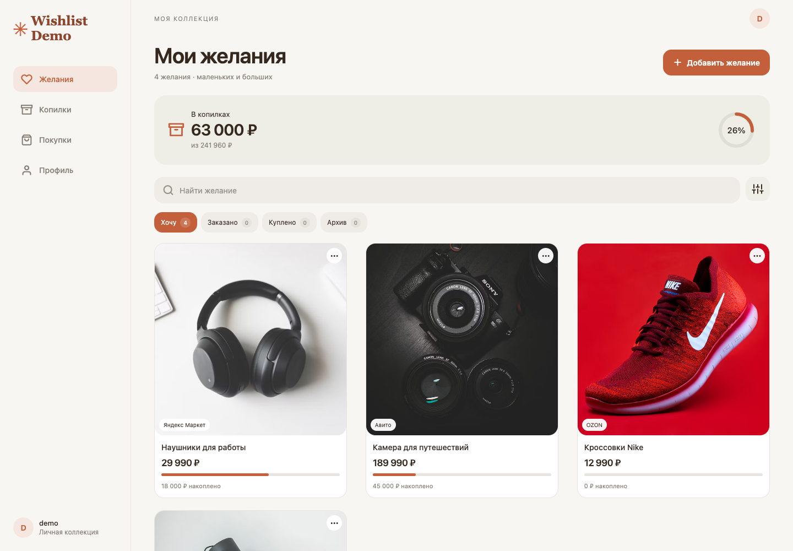
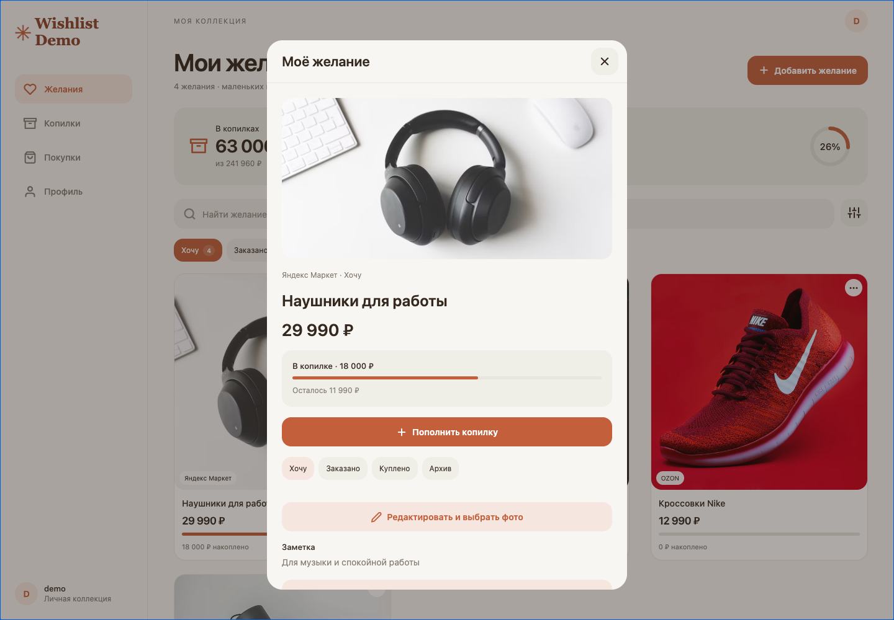
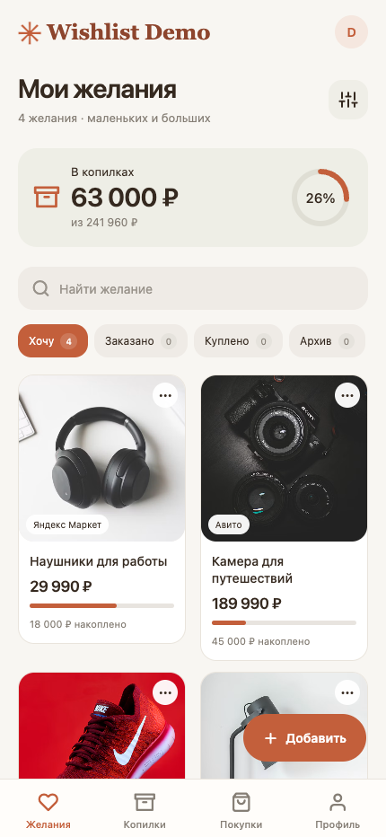

<a href="README.md">English</a> · <a href="README.ru.md">Русский</a>

<h1 align="center">Wishlist Planner</h1>

A personal wishlist that turns saved product ideas into an organized purchase plan.

   

A public showcase of a private project, presenting anonymized interfaces and key workflows. Source code and internal project materials remain private.

## Key workflows

- Save and organize purchase ideas
- Keep product notes and priorities
- Track savings toward a goal

## Gallery

Screens are presented individually with their proportions preserved. Identifying branding, contacts and data are replaced with demo content. These previews illustrate the product and do not imply a live service is available.

### Wishlist

### Item details

### Mobile collection

---

[Explore all projects](https://github.com/svllvsx)
